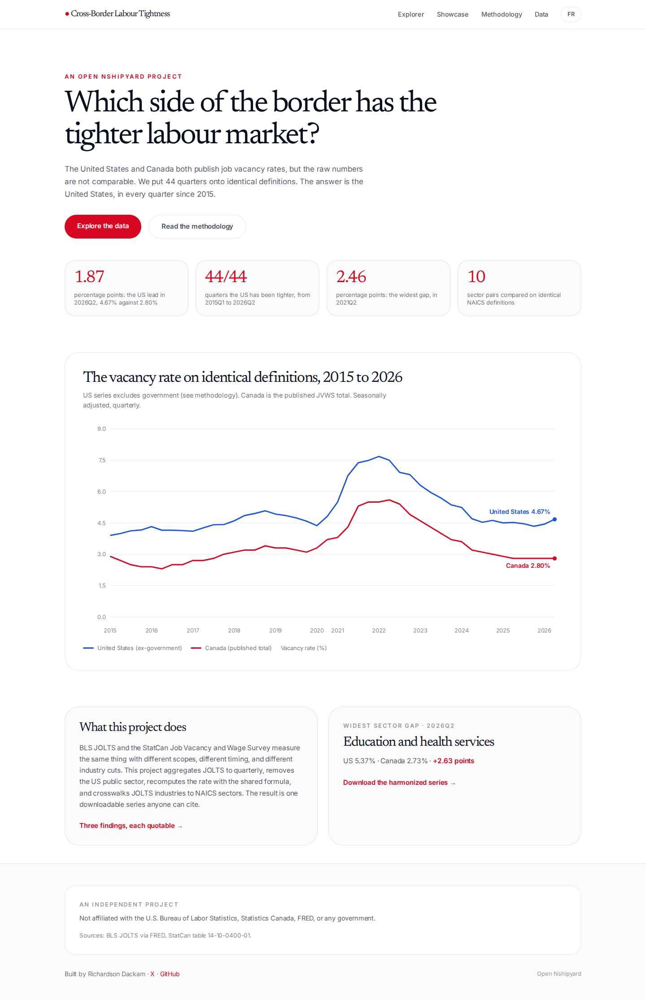
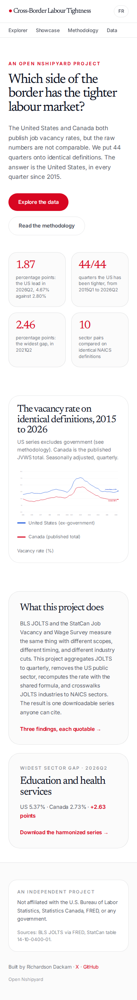
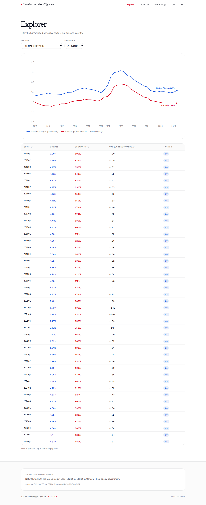
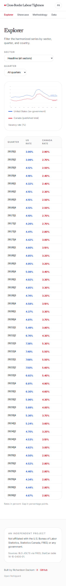
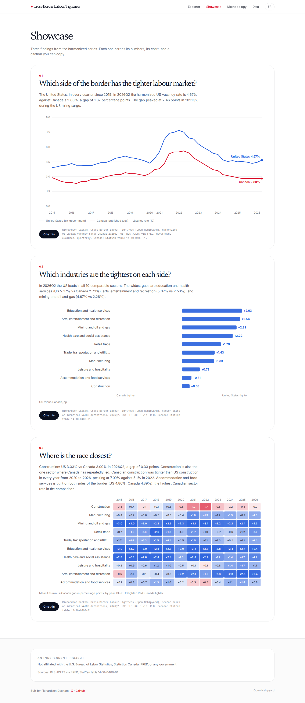
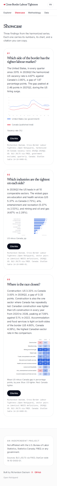
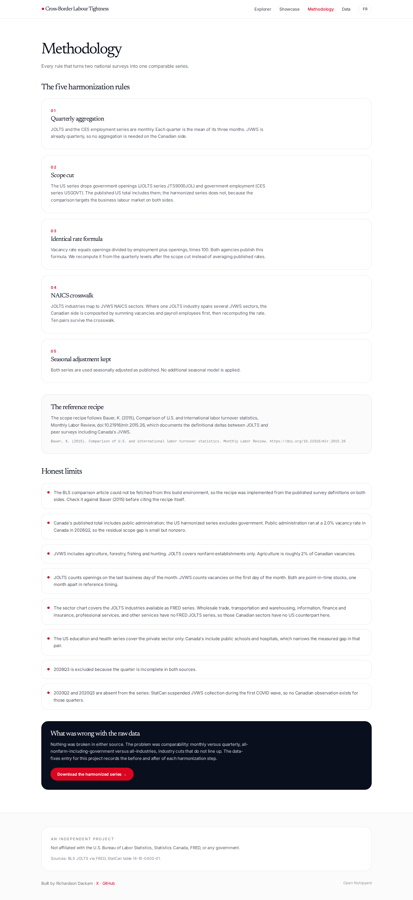
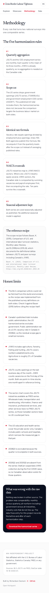
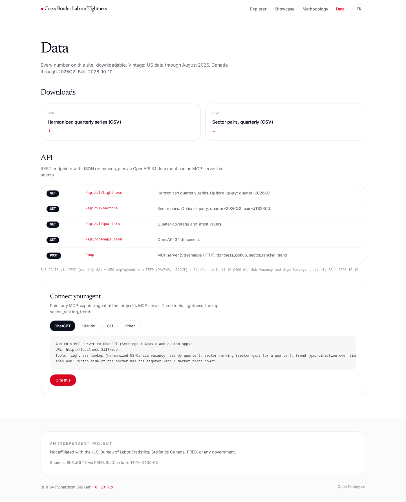
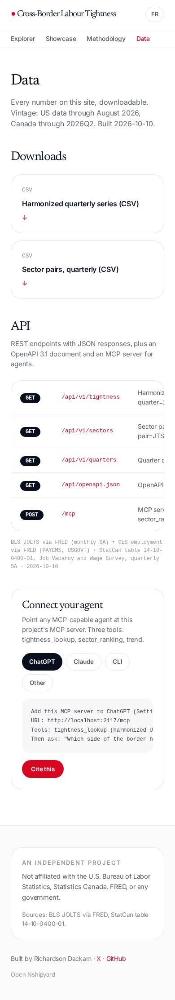

# Cross-Border Labour Tightness

Which side of the border has the tighter labour market? The US and Canada both publish job vacancy rates, but the raw numbers are not comparable: monthly vs quarterly, all-nonfarm-including-government vs all-industries, industry cuts that do not line up. This project harmonizes 44 quarters (2015Q1 to 2026Q2) onto identical definitions and publishes one citable series.

**Answer: the United States, in every quarter since 2015.** In 2026Q2 the harmonized US vacancy rate is 4.67% against Canada's 2.80%, a gap of 1.87 percentage points. The gap peaked at 2.46 points in 2021Q2.

## The five harmonization rules

1. **Quarterly aggregation.** JOLTS and CES are monthly; each quarter is the mean of its three months. JVWS is already quarterly.
2. **Scope cut.** The US series drops government openings (JOLTS JTS9000JOL) and government employment (CES USGOVT).
3. **Identical rate formula.** Vacancy rate = openings / (employment + openings) x 100, recomputed from quarterly levels after the scope cut.
4. **NAICS crosswalk.** JOLTS industries map to JVWS sectors; where one JOLTS industry spans several JVWS sectors, the Canadian side is composited by summing vacancies and payroll employees first. Ten pairs survive.
5. **Seasonal adjustment kept.** Both series are used seasonally adjusted as published.

The recipe follows Bauer, K. (2015), "Comparison of U.S. and international labor turnover statistics," Monthly Labor Review, doi:10.21916/mlr.2015.26. Full rules and honest limits: `/methodology`.

## Data sources

- US: BLS Job Openings and Labor Turnover Survey (JOLTS), monthly seasonally adjusted, via FRED. CES employment via FRED (PAYEMS, USGOVT). Retrieved 2026-10-10.
- Canada: Statistics Canada table 14-10-0400-01, Job Vacancy and Wage Survey, quarterly seasonally adjusted by industry sector. Retrieved 2026-10-10.

Raw files live in `data/raw/`. The build script `scripts/build_data.py` regenerates every computed file from the live sources (keyless).

## Run it

```bash
npm install
npm run build-data   # regenerate public/data/*.json and public/downloads/*.csv
npm run dev          # http://localhost:3000
npm run build && npm start
```

## API

- `GET /api/v1/tightness?quarter=2026Q2` - harmonized quarterly series
- `GET /api/v1/sectors?quarter=2026Q2&pair=JTS2300` - sector pairs on identical NAICS definitions
- `GET /api/v1/quarters` - coverage and latest values
- `GET /api/openapi.json` - OpenAPI 3.1
- `POST /mcp` - MCP server (Streamable HTTP): `tightness_lookup`, `sector_ranking`, `trend`

CSV downloads on the `/data` page.

## Screenshots

| Page | Desktop | Mobile |
|---|---|---|
| Home |  |  |
| Explorer |  |  |
| Showcase |  |  |
| Methodology |  |  |
| Data |  |  |

## Project files

- `showcase.md` - the showcase Q&A in EN and FR
- `charts.md` - chart insight specs in EN and FR
- `datafix-entry.md` - the data-fixes log entry in EN and FR
- `llms.txt` - agent-readable project summary
- `SKILL.md` - Claude Code skill for querying this project's data

## Author

Built by **Richardson Dackam** - [X](https://x.com/richardsondx) - [GitHub](https://github.com/richardsondx)

An independent project. Not affiliated with the U.S. Bureau of Labor Statistics, Statistics Canada, FRED, or any government.
